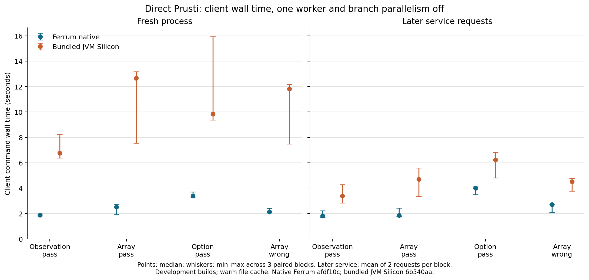

# Prusti and backend performance results

The latest [one-worker method-solver experiment](performance-method-solver.md)
reproduces lower solver work on the nested case and promising, noisy timing
results. It retains small-case overhead and leaves the new switch opt-in.

The preceding [term-cache investigation](performance-term-cache.md) restores
Silicon's lazy term hashing, measures a small-case improvement, and separates
parser costs from solver-lifecycle and saturation opportunities. Its bounded
measurements and unchanged SMT streams are separate from the older matrix below.

The later [live stdlib profiling follow-up](performance-live-stdlib.md) investigates
harder iterator cases in the adoption run. It finds substantial Z3 quantifier
matching in two short observed windows. Its workload, partial sampling and
concurrent regression-run timings remain separate from the experiment below.

Ferrum reduced client wall time on all four selected stdlib cases at the
one-worker, branch-parallelism-off baseline. Median paired JVM/native ratios
were **2.90–5.05× for fresh Prusti processes** and **1.52–2.53× for later service
requests**. Each result has three paired blocks. These are development builds on
one shared laptop; they establish a measured advantage for these cases and
settings, not a general result for every stdlib program or a comparison to Verus.

The chart shows medians and minimum–maximum ranges. Later service observations
are the means of two requests within each block, giving three independent block
values. Ratios below are medians of individual paired JVM/native ratios, so they
need not equal ratios of the displayed time medians. All times are seconds.

| Workload | Fresh native / JVM | Paired ratio | Later service native / JVM | Paired ratio |
| --- | ---: | ---: | ---: | ---: |
| `observation_pass` | 1.880 / 6.760 | 3.54× | 1.820 / 3.385 | 1.86× |
| `mut_element_array_pass` | 2.510 / 12.660 | 4.62× | 1.855 / 4.700 | 2.53× |
| `mut_element_option_pass` | 3.390 / 9.840 | 2.90× | 3.995 / 6.235 | 1.52× |
| `mut_element_array_wrong` | 2.140 / 11.820 | 5.05× | 2.710 / 4.505 | 1.66× |

The last case must fail verification. All 144 negative direct-Prusti requests
reported the expected assertion at Rust line 8. The other three cases verified.
First service requests were measured separately; their paired median ratios
range from 2.13–6.52×. See the [direct Prusti report](performance-prusti.md) for
all ranges, first-request results and worker/branch configurations.

## Where the work goes

The existing direct-Prusti spans give the following range of per-case medians
for native fresh requests at one worker with branch parallelism off:

| Measured span | Median seconds across the four cases |
| --- | ---: |
| Rust to VIR encoding | 0.132–0.366 |
| VIR conversion | 0.007–0.010 |
| Inclusive backend verification | 0.722–2.192 |

Backend verification is the largest of these recorded native spans. Native
frontend construction and consistency checking sit outside that span, and the
JVM span includes wrapper/polling work. These spans do not provide an exclusive
symbolic-execution/Z3 decomposition or account for every part of client wall time.

The separate parsed-Viper instrumentation experiment provides process CPU
accounting. At one worker with branch parallelism off, the median identified Z3
share of Ferrum's total accounted CPU was **11.9–21.4%** across the four cases.
The remaining CPU includes frontend, runtime, verification, wrappers and other
process work. Z3 process CPU itself includes startup, SMT parsing, solving and
cleanup. This is not a check-sat-only measurement, a percentage of direct-Prusti
wall time, or proof that the residual is all symbolic execution.

The parsed-Viper phase records also show native semantic analysis taking
0.241–1.990 seconds in the later-request per-case medians at that setting.
That is a useful target for `.vpr` workflows. The direct Prusti adapter constructs
the AST directly and skips that parsing/semantic-analysis path, so improving it
would not directly address the measured Rust client path.

Instrumentation overhead varied substantially, especially on the JVM. The
plain, timed and solver-accounted variants were measured in separate sessions
within matched blocks; they do not support a stable overhead correction or a claim that
instrumentation is free. Primary parsed-backend speed ratios use plain drivers.
Direct Prusti uses its existing phase logging; its logging overhead was not
separately measured. The [profiling report](performance-profile.md) retains
every overhead ratio, phase and CPU observation.

## Parallelism and next optimization work

Workers 1/2/4 and branch parallelism off/on were exercised in both primary
experiments. Neither more workers nor branch parallelism consistently reduced
latency across these small cases. For example, in parsed three-request native
sessions, four workers with branches on took 1.29× the baseline median for the
option case and 1.46× for the negative array case. Other configurations improved
individual cases. The detailed reports preserve the mixed results and their
wide ranges; this sample does not justify increasing the default worker count.

The next optimization experiment should sample native verification and setup
CPU and allocations on these same direct-Prusti cases, then on larger iterator
workloads. The measured backend span and broad non-Z3 CPU share make this a
better-supported starting point than assuming Z3 dominates. A hotspot profile
can distinguish term/state cloning, allocation, setup and other costs before
choosing a code change. No such hotspot identification is claimed here.

For standalone `.vpr` use, profile semantic analysis separately. For throughput
and parallelism decisions, add larger obligations and repeat with optimized
builds under a controlled host configuration. The present evidence does not
select immutable snapshots or a permission-representation redesign as the first
optimization; those changes would also need dedicated soundness validation.

## Completed coverage and provenance

| Experiment | Completed evidence | Audit result |
| --- | --- | --- |
| Parsed Viper, fresh / three-request sessions | 480 sessions, 240 paired blocks, five repetitions | All valid; zero invalid or censored |
| Direct Rust, fresh / first and later service requests | 576 requests, 144 service cleanup audits, three repetitions | All valid; all service audits clean |
| Separate plain / timed / solver-accounted profiling | 144 sessions, 48 matched blocks, three repetitions | All valid; all blocks eligible |

Every trial checks the expected outcome and diagnostics. The parsed negative
case retains its exact failure ID and Viper span. Independent audits check
frozen artifacts, schedules, timers, phase records and cleanup/accounting where
applicable. Failed preparation/pilot attempts remain separately documented and
are not substituted into the primary observations. This stage changed measurement
tools and documentation; production runtime and optimization settings stayed fixed.

Ferrum runtime is `afdf10cf59106c38d09df32939f1aa9c77d0b989`; Prusti is
`a59ed917c1c3c4c4ca6ff1de12ad20d48491d021`. Direct Prusti uses its bundled JVM
Silicon `6b540aa4`. The separate parsed-backend experiment uses pinned Silicon
`ff386aec4664231dc6f2cb56d8d35f1623088363` and Silver
`c4f54b84703a04434b03e97bfea87dbd09870fd2`. These source versions and experiments
are kept separate. The parsed one-worker/branch-off median paired ratios are
1.79–5.38× fresh and 1.78–3.04× for whole three-request sessions; the latter
cannot be divided into independent request latencies. One reused option pair
favored the source backend despite the native-favoring group median.

The Intel i5-1345U host has 12 logical CPUs and approximately 32 GB RAM, with
recorded powersave governors. Ordinary background processes remained running.
Builds are development profiles: standalone Rust 1.89 uses opt-level 1; Prusti
nightly-2026-08-15 uses debug=1/default opt-level 0 with the three Ferrum crates
at opt-level 1. This is not a release-build study. Artifact hashing and preceding
trials warm filesystem caches. Prusti result caching was off; Silicon internal
caches were on, unlike the preceding compatibility-driver runs.

Service reuse retains a process-level JVM object but constructs verifier state
per request. It does not establish solver reuse. Socket readiness mostly reflects
the readiness polling interval and is not JVM startup time. Client CPU does not
include the live service and its solvers. Process accounting covers observed,
identified descendants and passed real normal/timeout controls; it cannot prove
that no unobserved descendant escaped. Overlapping worker and solver wall spans
were never subtracted to manufacture an exclusive symbolic-execution time.

The [compatibility comparison](compatibility-final.md) is complete with its 15
inconclusive timeout pairs and documented rendering/source limitations. The full
602-client Rust matrix remains the historical stage-3 run; these four fresh
performance cases do not replace that matrix at the final runtime pin.

## Evidence and reproduction

- [Parsed backend report](performance-backend.md) and [structured evidence](performance-backend.json).
- [Direct Prusti report](performance-prusti.md) and [structured evidence](performance-prusti.json).
- [Phase/CPU report](performance-profile.md) and [structured evidence](performance-profile.json).
- [Frozen protocol](performance-protocol.md), [readiness checks](performance-validation.md),
  [CPU accounting controls](performance-accounting-controls.json) and
  [service lifecycle](performance-service-lifecycle.md).
- [Measurement tools](../tools/performance/README.md) and
  [byte-preserved Viper fixtures](../tools/performance/fixtures/README.md).
- [Figure provenance](figures/prusti-client-wall.json),
  [SVG](figures/prusti-client-wall.svg) and
  [rendering instructions](figures/README.md).
- [Earlier parser and continuation optimization checkpoints](performance-earlier.md),
  kept separate from this comparative experiment.

The committed structured evidence preserves all trial records and links raw
local logs, binaries and source snapshots by hash. It is not a self-contained
archive of those local artifacts. Reproduction requires the pinned dependencies,
builds and new immutable manifests described by the tools.
